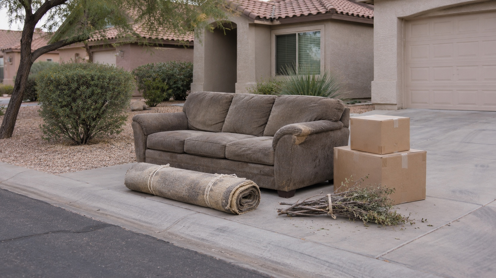
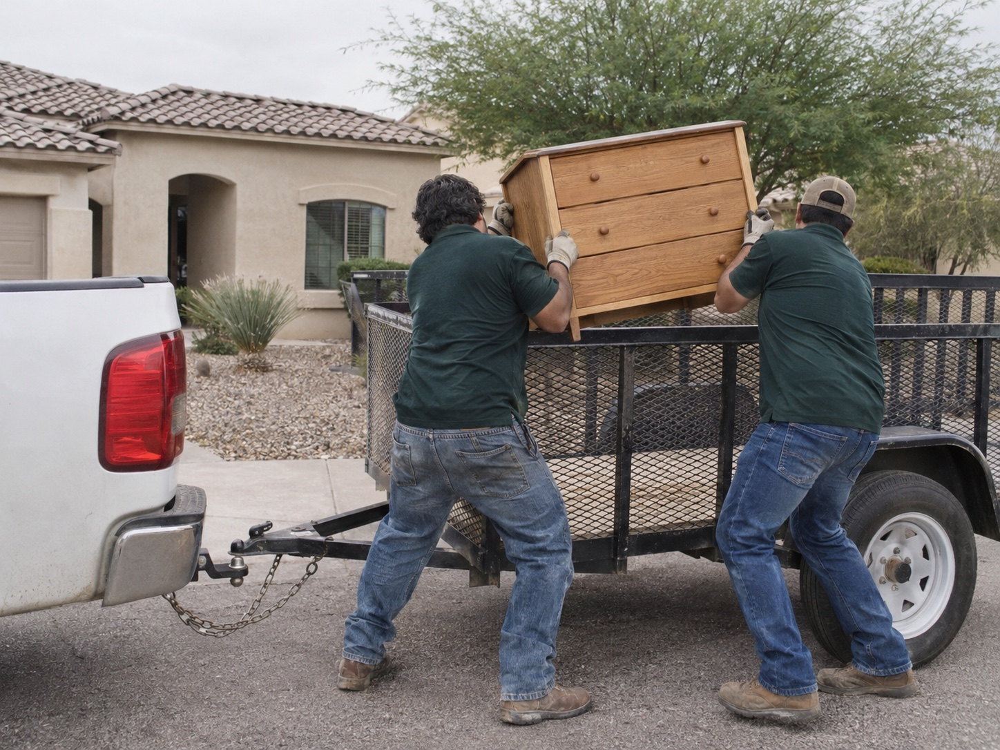
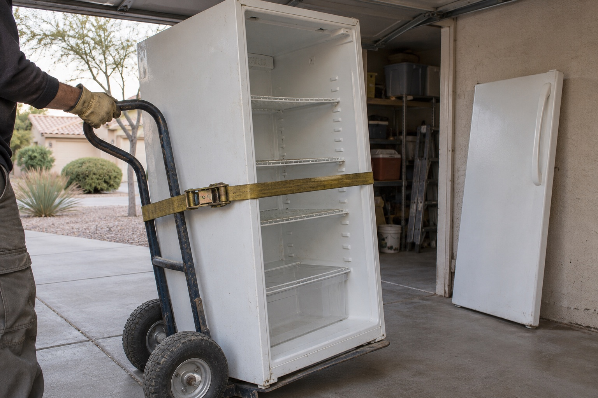

You have a pile in the garage and one question: can the City of Mesa take it, or
do you need a hauler? Often the city can, and when it can, it is the cheaper
choice. Every city fact below links to its source page, so you can check the
current numbers before you book.

## How Mesa bulk item pickup works

Mesa runs a scheduled [bulk item pickup](https://www.mesaaz.gov/Utilities/Trash-Recycling/Bulk-Item-Pick-up)
for its Solid Waste customers. It is not free and it is not automatic. Request
it ahead online or at 480-644-6789.

- Starting price: $31.00 per load for Mesa trash and recycling customers,
  $39.59 per load for non-Mesa customers.
- A load is about 4 feet by 8 feet by 4 feet, up to four loads per pickup.
- The pile goes at the end of your driveway, off the sidewalk, after 6 p.m. the
  night before and no later than 6 a.m. on collection day.
- Small items are boxed, bagged or bundled. Branches and carpet are cut and
  tied into bundles no more than 24 inches across, 48 inches long or 60 pounds.
  Cacti go in small boxes. Furniture needs no prep.

There is a $31.00 trip charge if you cancel with less than one business day of
notice, if the items are not at the curb, or if they are not prepared the way
the city asks. If a banned item is mixed in, the city can leave the whole load
and still charge the trip fee.

HOA and multi-unit residents may need to go through their property manager,
the city notes.

## What the city takes, and what it refuses

The accepted list on the [city page](https://www.mesaaz.gov/Utilities/Trash-Recycling/Bulk-Item-Pick-up)
covers the normal household pile: furniture, mattresses, bed frames and box
springs, exercise machines, bicycles, wheelbarrows, toilets, water softeners,
TVs, grills with the propane removed, mowers drained of gas, palm fronds,
bundled branches, carpet and shelves, boxed cacti, and small household items or
yard debris in boxes or bags.

The prohibited list is just as clear:

- Appliances, including microwaves and air compressors
- Construction and remodeling material: cabinets, countertops, tile, brick,
  drywall, concrete, rock, dirt, shingles, lumber, pallets, sinks, tubs and doors
- Hazardous waste such as oil, paint, batteries, light bulbs and propane tanks
- Liquids and tires

The city also notes that single or bundled items over 60 pounds may be
ineligible. A sleeper sofa or a solid wood dresser can sit right on that line.

## Three other city routes worth knowing

**Appliance pickup.** Mesa runs a separate curbside
[appliance recycling](https://www.mesaaz.gov/Utilities/Trash-Recycling/Appliance-Recycling)
service, also scheduled ahead. Mesa customers pay $19.00 per appliance, plus
$11.00 for Freon removal on anything with refrigerant. Non-Mesa customers pay
$28.42, plus the $11.00. Appliances must be empty, with doors, hinges, lids,
glass shelves and latches removed from fridges and freezers.

**Free appliance drop-off.** Mesa residents can take up to two appliances a day
to the [Household Hazardous Materials facility](https://www.mesaaz.gov/Utilities/Trash-Recycling/Resident-Programs/Household-Hazardous-Materials)
at 2412 N. Center St., Wednesday through Saturday, 7 a.m. to 2 p.m., at no
extra cost for residents who pay the Green & Clean fee. Bring proof of
residency.

**The Landfill Use Program.** Mesa trash customers with an eligible rate code
can dump one load a month, up to 2,000 pounds, for $15.00 through the
[Landfill Use Program](https://www.mesaaz.gov/Utilities/Trash-Recycling/Resident-Programs/Landfill-Use-Program).
Cover and tie down the load, and bring your utility bill and photo ID. Over
2,000 pounds, the whole load is charged at the facility's rate.

## When the city is the sensible choice

Use bulk pickup when your pile is a few pieces of furniture, a mattress, a
grill or a stack of palm fronds, everything is under the weight line, and you
can wait for your scheduled day. For $31 and a little bundling, that beats
paying anyone to haul it. With a truck and one heavy load a month, the $15
landfill program is a good deal too.

## When a hauler is the better call

A crew makes sense when the pile stops fitting the city's rules:

- **It is mixed.** A fridge, a broken vanity, a sofa and bags of trimmings
  mean an appliance pickup, a bulk pickup and a landfill run. A
  [junk removal](/services/junk-removal) crew takes it all in one visit,
  [appliances](/services/appliance-removal) and
  [yard waste](/services/yard-waste-removal) included.
- **It is remodel debris.** Cabinets, tile, drywall and old doors are banned
  outright. That is a [construction debris](/services/construction-debris-removal) job.
- **It is heavy.** Anything over 60 pounds may be left at the curb. We load it
  from where it sits.
- **It is inside.** The city collects from the driveway. We carry from the
  bedroom, garage or backyard, so nothing waits outside.
- **There is a deadline.** A listing shoot, a tenant moving in or an HOA limit
  on curb time will not wait for the next bulk date. Call early and send
  photos, and we can often fit a
  [same-day or next-day pickup](/services/same-day-junk-removal) into an
  existing East Valley route.
- **You have no truck.** The landfill program only works if you can get the
  load there.

Our prices are on the [pricing page](/pricing). A single item starts at $110
and a full 9 cubic yard trailer starts at $550, plus $35 for each fridge,
freezer or air conditioner because the refrigerant is handled separately.

## Use both

Put the light, legal items out for the
city on your scheduled day. Then send us photos of what is left: the appliances,
the heavy pieces and anything that has to be gone before a date. You get the
price before anything is loaded.

[Send photos and get your price](/quote), or call (480) 650-0905.
