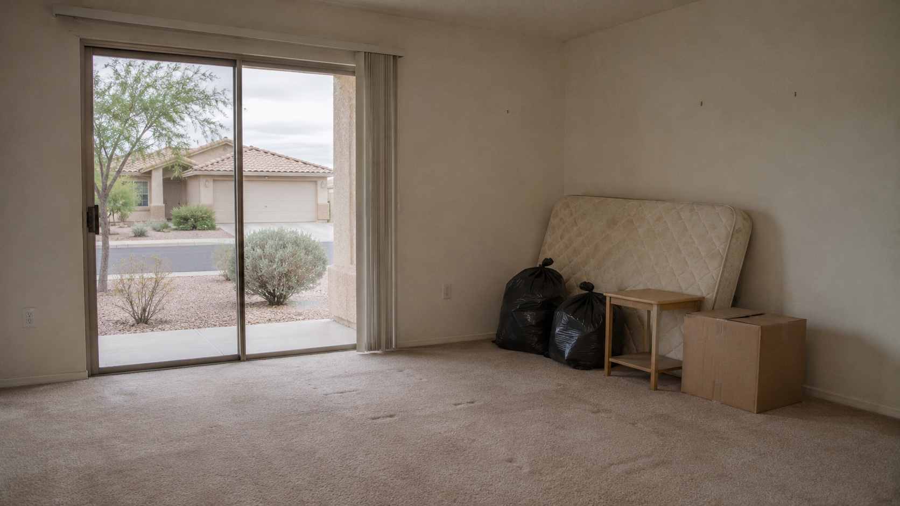
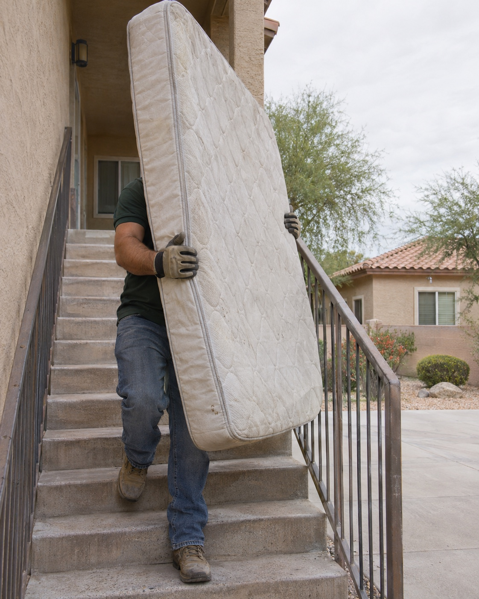
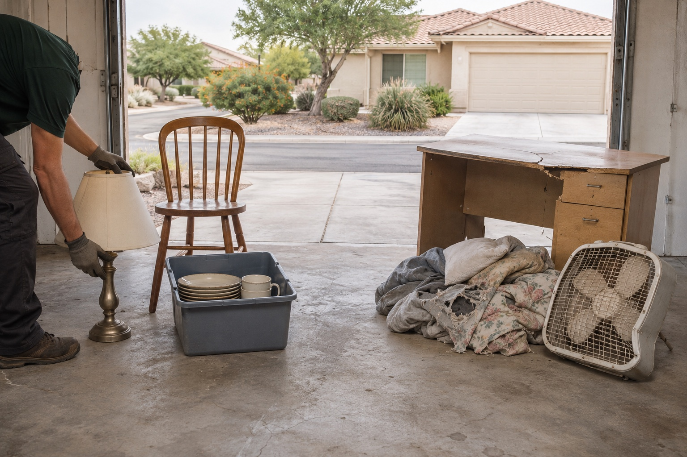

The tenant is gone and the unit is not empty. A mattress, bags of clothes, a
desk, a fridge full of food. Before anyone loads a trailer, Arizona law
has a say in what you can throw out and when.

This is a plain-English summary of two statutes,
[A.R.S. 33-1370](https://www.azleg.gov/ars/33/01370.htm) and
[A.R.S. 33-1368](https://www.azleg.gov/ars/33/01368.htm), for landlords and
property managers in Mesa and the East Valley. It is not legal advice. Read the
current statute or ask an attorney before you dispose of anything.

## When a unit counts as abandoned

A.R.S. 33-1370 covers abandonment. It means the tenant has been absent without
notice for at least seven days, with rent ten days unpaid and nothing but their
belongings suggesting anyone lives there. Or absent at least five days, with
rent five days unpaid and none of their property in the unit.

Before retaking the unit, the landlord sends a notice of abandonment by certified
mail, return receipt requested, to the tenant's last known and alternate
addresses, and posts it on the door or another conspicuous place on the
property for five days. Five days after it has been
both posted and mailed, the landlord may retake the unit. How to handle that
notice is a question for your attorney.

## The 14-day hold

Once you have retaken possession and the tenant's property is still inside, the
statute says:

- Inventory the property and tell the tenant where it is and what storage
  costs, the same way as the abandonment notice.
- Store it with reasonable care, in the unit, another unit, storage you own, or
  off the premises.
- Hold it for fourteen calendar days after retaking possession.

Perishables, plants and animals need not be stored, and contaminated property,
a possible biohazard or a health and safety risk may be removed and disposed of.
Animals have their own rules in the statute.

Often missed:

- **A returned key changes things.** If the tenant returned the keys and left
  property behind, you may remove and dispose of it without liability, unless
  you agreed otherwise in writing.
- **Clothing, tools of a trade, identification and financial documents** can be
  collected by the tenant without paying storage costs first.
- **The reclaim window.** If the tenant gives written notice, on or before the
  day you sell or dispose of the property, that they intend to remove it, they
  get five days, paying only removal and storage costs.

## After the hold ends

If the tenant made no reasonable effort to recover the property in those
fourteen days, you may donate it to a qualifying charity or sell it. Sale
proceeds go toward unpaid rent and the costs the statute covers, with the rest
mailed to the tenant's last known address. Keep records of the rent and the
sale for twelve months.

Property worth so little that moving, storing and selling it would cost more
than a sale would bring can be disposed of. That judgment is yours to make
and to record. When it applies, a cleanout crew comes in.

## After an eviction

[A.R.S. 33-1368(E)](https://www.azleg.gov/ars/33/01368.htm) says that on the
day after a writ of restitution is executed, the landlord must comply with
subsections D through I of 33-1370. The same inventory, notice, fourteen-day
hold and reclaim window apply after an eviction. How to pursue one is outside
this post. Ask your attorney.

Keep dated photos of every room before anything moves, a written
inventory and copies of your notices, in case the tenant later asks where their
property went.

## Day 15: what the cleanout looks like

Once the hold has run and you know what is donated, sold or disposed of,
the job is a [foreclosure and eviction cleanout](/services/foreclosure-cleanouts).

**Mark what stays.** Anything on hold or disputed gets a note before the crew
arrives.

**Sort at the property.** Usable furniture and household goods are set aside for
donation. Mattresses and particleboard furniture
have little reuse value and go for disposal, and
[mattress removal](/services/mattress-removal) and
[furniture removal](/services/furniture-removal) are the bulk of most turnovers.

**Appliances need a step first.** Refrigerators are taken once disconnected and
ride apart from the load because of the refrigerant, so tell us one is coming.
Washers and dryers must be disconnected first, and a gas dryer's line shut off by
a qualified person. We do not disconnect plumbing or gas.

**Some things never go on the trailer.** Hazardous waste, wet paint and
solvents, fuels and propane tanks, pool chemicals and biohazards need a licensed
handler, not a junk crew.

## Getting the unit earning again

Painters and carpet installers cannot start in a full unit, so the cleanout goes
first and the date matters more than the load. We carry from inside, so nothing
sits at the curb for an HOA to notice.

Many turnover jobs run with nobody on site, once the scope is agreed from photos
and the crew has a gate code or a lockbox.

In [Tempe](/locations/tempe-az), student housing turns over at the end of each
academic year, and the work is mostly mattresses and particleboard furniture
moved through elevators and busy loading zones. Send the building's rules and we
plan around them.

## What to send for a quote

Photos of each room, the garage and the patio. Access details: floor, elevator,
stairs, gate code, parking. The date the repair crew needs the unit. You get an
upfront price before anything is loaded, from the
[residential junk removal](/services/junk-removal/residential-junk-removal) crew.

This is a summary, not legal advice. Statutes change. Read the
current text of [A.R.S. 33-1370](https://www.azleg.gov/ars/33/01370.htm) and
[A.R.S. 33-1368](https://www.azleg.gov/ars/33/01368.htm), or ask an attorney,
before you dispose of a tenant's property.

[Send photos and get your price](/quote), or call (480) 650-0905.
